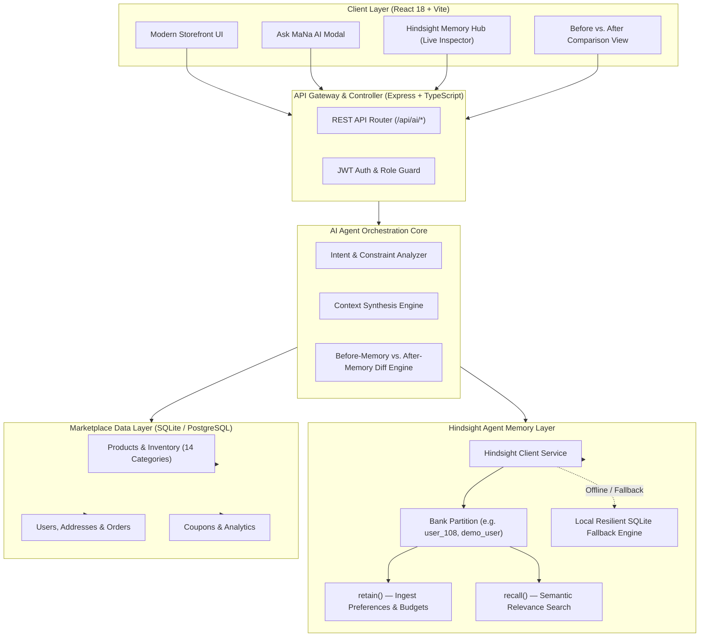

# 🏛️ Architecture & System Design: MaNa Angadi Memory Concierge

**Flagship Product:** MaNa Angadi (మన అంగడి)  
**Core Innovation:** Hindsight Persistent Agent Memory for Hyper-Personalized Regional Commerce & Procurement  

---

## 1. High-Level System Architecture Diagram



---

## 2. The Core Workflow: Retain → Recall → Act

### Step 1: Ingestion & Retention (Interaction 1)
1. The user interacts with the assistant: *"I need to buy Pochampally handlooms and cold-pressed oils for my niece's wedding in Hyderabad, keep budget under ₹10,000."*
2. The `AIAgentService` parses domain entities:
   - **Occasion**: Wedding / Auspicious occasion
   - **Budget Ceiling**: ₹10,000
   - **Regional Craft**: GI-Tagged Pochampally Silk Handlooms
   - **Dietary Restriction**: 100% Organic Cold-Pressed Oils
3. The `HindsightService` calls `retain()` to persist these facts into the user's isolated Bank ID (`demo_user_hindsight`).

### Step 2: Semantic Recall (Interaction 2 / Days Later)
1. The user returns and asks: *"Show me suitable gifts for the ceremony."*
2. The stateless system would be blind to previous context. But `MaNa AI` calls `hindsightService.recall(bankId, query)`.
3. Hindsight returns the ranked memory items:
   - `[Score 0.96]` Customer purchase budget ceiling is under ₹10,000
   - `[Score 0.94]` Customer prefers authentic GI-Tagged Pochampally Handlooms
   - `[Score 0.90]` Customer is procuring gifts for niece wedding
4. The synthesizer injects these constraints directly into the SQL query and the response generation prompt.

### Step 3: Context-Aware Recommendation & Memory Trace
1. The backend queries products that strictly satisfy `price <= 10000` and `category = 'local-products'` or `saree`.
2. The UI renders both the tailored product cards and an explicit **Memory Trace** showing judges and users:
   - Exactly what was recalled
   - Why it was relevant
   - The tangible Before vs. After difference.

---

## 3. Database Schema & Memory Isolation

Each memory is partitioned by a unique `bank_id`:
```sql
CREATE TABLE IF NOT EXISTS hindsight_memories (
  id TEXT PRIMARY KEY,
  bank_id TEXT NOT NULL,
  content TEXT NOT NULL,
  category TEXT DEFAULT 'general',
  metadata TEXT,
  created_at TEXT NOT NULL
);

CREATE INDEX IF NOT EXISTS idx_hindsight_bank ON hindsight_memories(bank_id);
```

---

## 4. Resilience & Error Handling Architecture

1. **Remote + Local Dual Engine**: If `HINDSIGHT_API_URL` is available, requests are routed to Vectorize Hindsight Cloud. If unavailable or during offline testing, the system automatically falls back to local SQLite semantic search without throwing errors.
2. **Timeout Protection**: Strict 4000ms timeout aborts ensure user conversations never hang.
3. **Safe Validation**: Empty queries or missing bank identifiers are safely handled with HTTP 400 validation responses.
